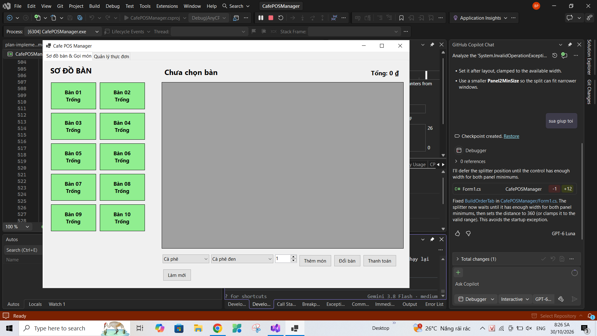
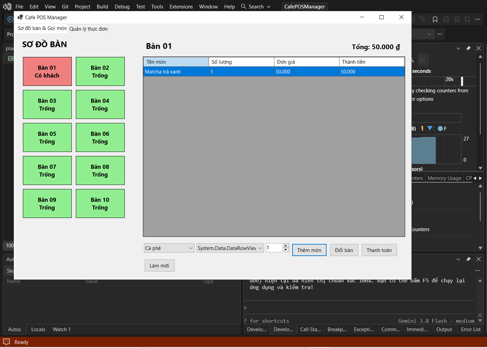
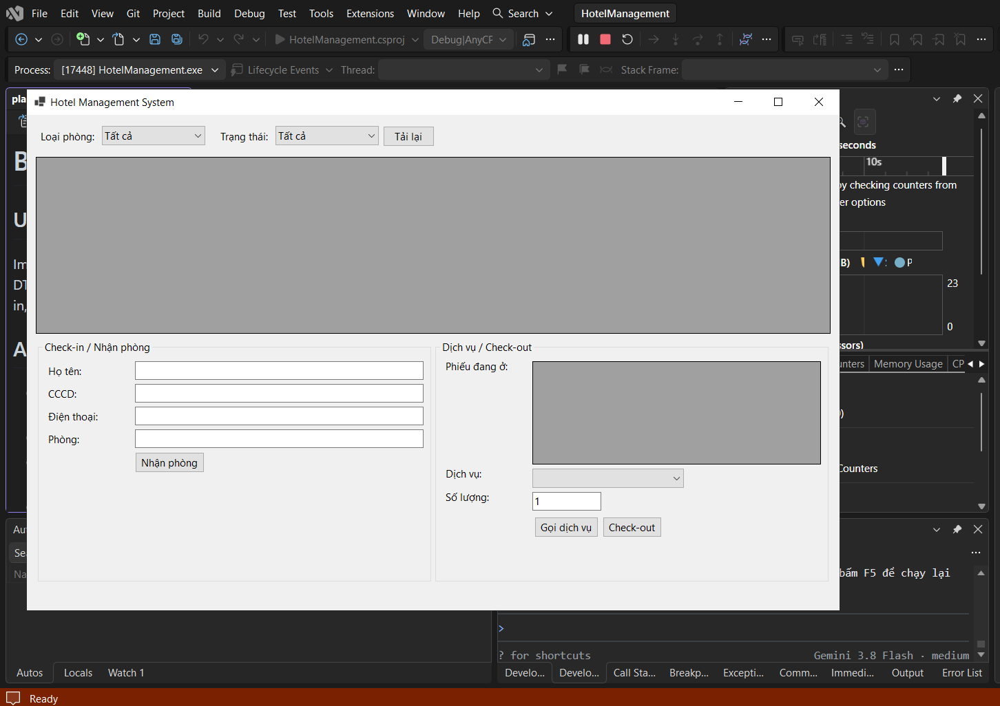
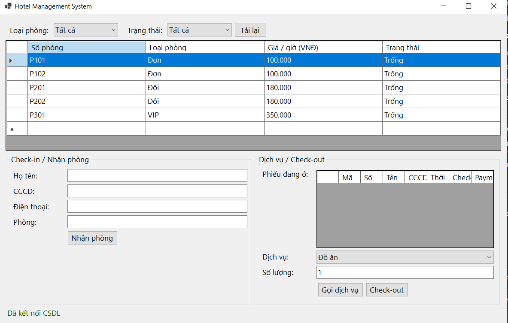
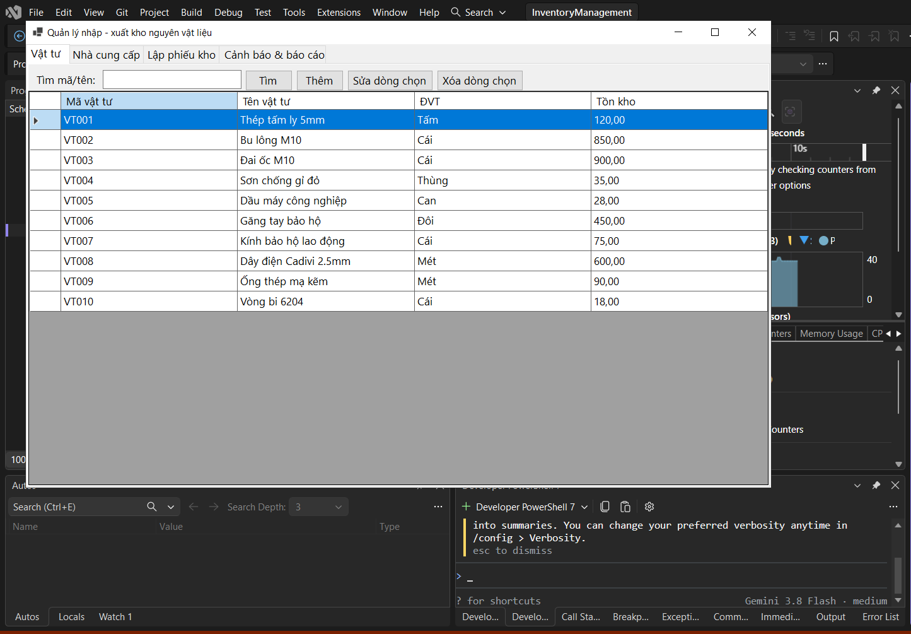
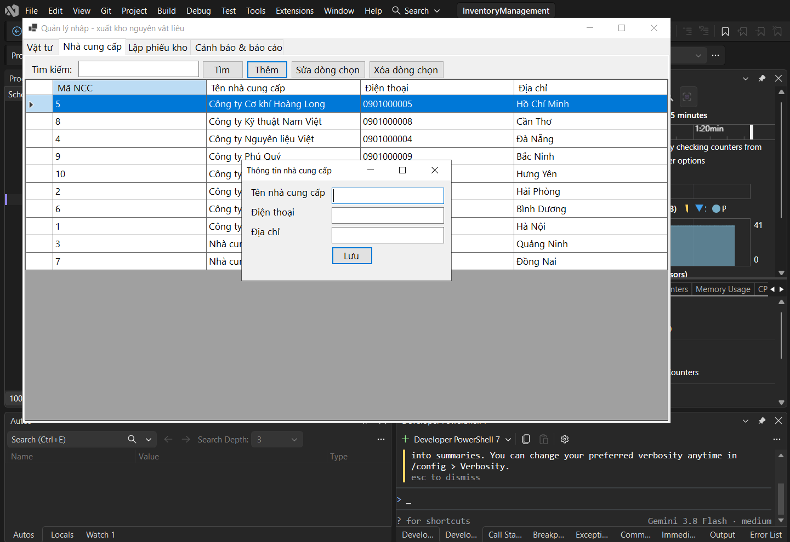

# BÁO CÁO THỰC HÀNH ỨNG DỤNG WINDOWS FORMS KẾT NỐI CSDL (BÀI 5.3, 5.4, 5.5)

## MỤC 1: THÔNG TIN SINH VIÊN
* **Họ và tên sinh viên:** Phạm Gia Bảo
* **Mã sinh viên:** 24810320309
* **Tên Đề tài / Bài tập:** Thực hành WinForms kết nối CSDL (Bài 5.3: CafePOSManager, Bài 5.4: HotelManagement, Bài 5.5: InventoryManagement)
* **Link Repository:** https://github.com/gsphamgiabao/-Thuc_hanh_30-10-2026-ung_d-n_Window_Form_ket_noi_CSDL-_5.3_5.4_5.5

---

## MỤC 2: HƯỚNG DẪN CÀI ĐẶT & CHẠY DỰ ÁN
1. Mở SQL Server Management Studio (SSMS), chạy file `Database/ScriptDB.sql` trong từng thư mục dự án để khởi tạo CSDL và dữ liệu mẫu.
2. Mở file `.sln` hoặc `.slnx` bằng Visual Studio 2022.
3. Mở file cấu hình (`App.config` hoặc `DatabaseHelper.cs`), sửa lại chuỗi kết nối `ConnectionString` cho phù hợp.
4. Build & Run dự án (F5).

---

## MỤC 3: HÌNH ẢNH KẾT QUẢ CÁC MÀN HÌNH CHỨC NĂNG

### 1. Bài 5.3: Quản lý Quán Cafe (CafePOSManager)

---

### 2. Bài 5.4: Quản lý Khách sạn (HotelManagement)

---

### 3. Bài 5.5: Quản lý Kho hàng (InventoryManagement)

